# **MATIMU MABUNDA**

#### **Web Developer | Graphic Designer**

#### **PROFILE** 
A highly motivated ICT Multimedia student in the Cape Peninsula University of technology who has a lot of talent in the fields of web development, graphic design and project management. A person who is good at solving problems and prefers to work on the outcomes and learn new technologies.  

_______________________________________________________________________________________________________________________________________
#### **CONTACT**
**Email:** [230533841@mycput.ac.za](230533841@mycput.ac.za " Student Email")

**LinkedIn:** [https://www.linkedin.com/in/matimumabunda-4a1377391](https://www.linkedin.com/in/matimumabunda-4a1377391 " Linkedin Account")

**Phone:** 079 842 1342 

**Location:** Old Marine Dr Street Foreshore, Cape Town, 8001

_________________________________________________________________________________________________________________________________________
#### **EDUCATION** 

**Matric 2021** : 
Hluvuka High School | Limpopo |Ka-Bungeni |

**Diploma 2026**: (ICT In Multimedia) Cape Peninsula University of Technology

Cape Town, District 6 

_________________________________________________________________________________________________________________________________________
#### **EXPERIENCE** 

##### **Internet Café Assistant (Part-Time)**
* Provided cretive design and technical support to clients.
* Designed wedding cards, branding, adverts.

##### **Application Development Experience** 
* Developed web and mobile applications using HTML, CSS,
JavaScript, PHP, and Node.js
* Designed User interfaces and prototypes using Figma.

_________________________________________________________________________________________________________________________________________
#### **PROJECTS**

##### **MediWing Healthcare Delivery Web Application**
* Came up with a responsive medical care landing page.
* Web features Implemented with HTML, CSS, JavaScript.
* Project Link: [Mediwing](https://mabundamatimu-hum.github.io/MediWing/  "Mediwing Website")

##### **Multimedia Brading Design Project**
 
 * Designed my branding content.
 * Project Link: [MM Studio](https://drive.google.com/file/d/1LRla_1d8H_fsxHjxSAd7kB_IIdBb7M6/view?sp=sharing  "Matimu Mabunda Studio")

_________________________________________________________________________________________________________________________________________
##### **TECHNICAL SKILLS**  
* Figma tools, UI / UX design, and prototyping.
* Node.js, React.js, AngularJS full-stack web development.
* Composition of the frontend based on HTML, CSS and responsiveness.
* High problem orientation and user-orientedness.
* PHP and SQL integration of web development and database.
* Multimedia and visual design: adobe In Design and adobe Illustrator.

_________________________________________________________________________________________________________________________________________
##### **PROJECT EXPERIENCE** 
* Headed 5 members in group projects and managed team activities.
* Deadlines were adhered to and the tasks were organised.
* Coached team members as well as promoted cooperation.

 ________________________________________________________________________________________________________________________________________
##### **REFERENCES** 
* Mrs. Hamman M                          
* Lecture                                      
* 083 381 9056                                     
* [hammanm@cput.ac.za]( hammanm@cput.ac.za " Mrs. Hamman M. Email" )         

* Mr. Chauke V.A                                  
* Internet Café (Manager)  
* 082 059 8866 
* [vonaniadrew03@gmail.com]( vonaniadrew03@gmail.com " Mr. Chauke V.A Email" )
 
  
  

-----------------------------------------------------------------
  
# **Mock Interview Video.**                             

<video src="./Mock Interview Video.mp4" type="video/mp4" controls width="600"></video>

---

# **GitHub Portfolio - WIL Projects - WaterWatch System**

## **Agile Team Charter**

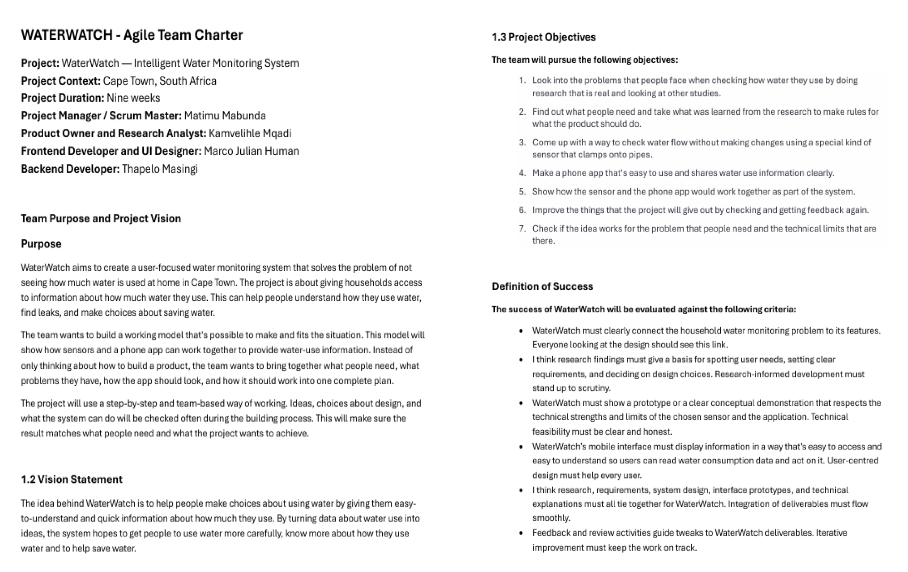

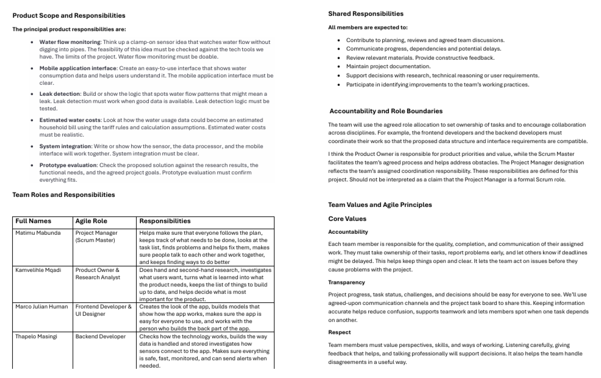

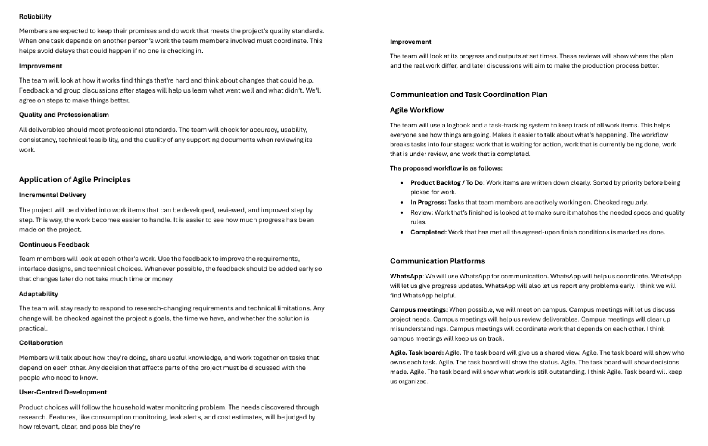

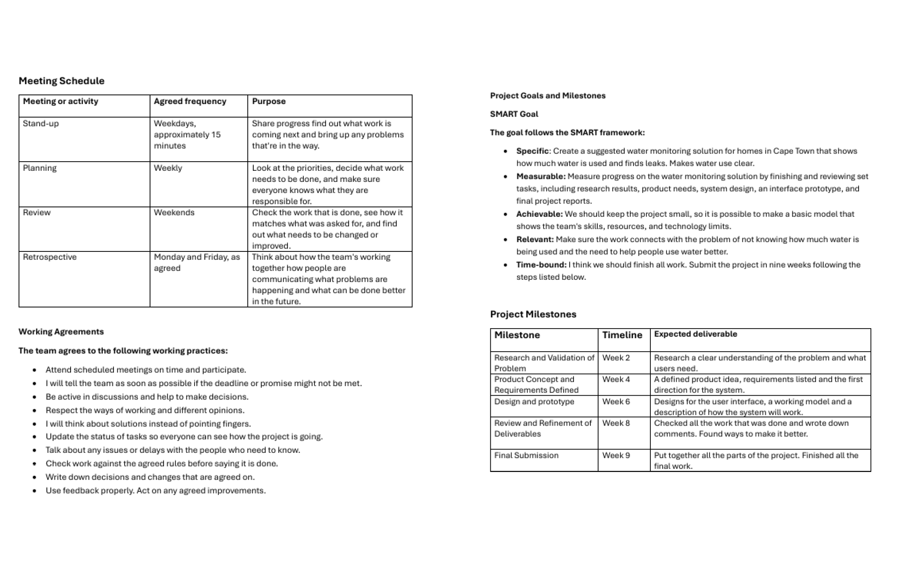

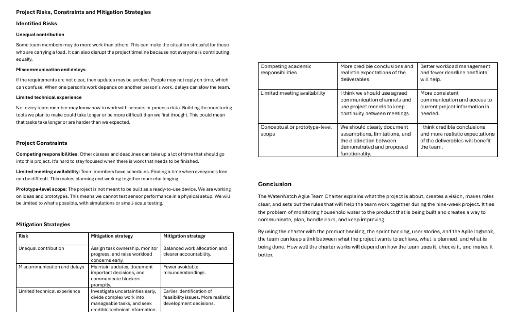

### **Purpose**
The goal of WaterWatch is to create a user-focused water monitoring system that solves the problem of not seeing how much water is being used at home in Cape Town. The project is about giving households access to information about how much water they use. This can help people understand how they use water find leaks and make choices about saving water.

The team wants to build a working model that's possible to make and fits the situation. This model will show how sensors and a phone app can work together to give information about water use. Of only thinking about how to build a product the team wants to bring together what people need what problems they have, how the app should look and how it should work into one complete plan.

The project will use a step-by-step and team-based way of working. Ideas, choices about design and what the system can do will be checked often during the building process. This will make sure the result matches what people need and what the project wants to achieve.

### **Vision Statement**
The idea behind WaterWatch is to help people make choices about using water by giving them easy-to-understand and quick information about how much they use. By turning data about water use into ideas, the system hopes to get people to use water more carefully, know more about how they use water and to help save water.

## **Project Objectives**
### **The team will pursue the following objectives:**
 -	Look into the problems that people face when checking how water they use by doing research that is real and looking at other studies.
 -	Find out what people need and take what was learned from the research to make rules for what the product should do.
 -	Come up with a way to check water flow without making changes using a special kind of sensor that clamps onto pipes.
 -	Make a phone app that's easy to use and shares water use information clearly.
 -	Show how the sensor and the phone app would work together as part of the system.
 -	Improve the things that the project will give out by checking and getting feedback again.
 -	Check if the idea works for the problem that people need and the technical limits that are there.

## **Definition of Success**
### **The success of WaterWatch will be evaluated against the following criteria:**
 - WaterWatch must clearly connect the household water monitoring problem to its features. Everyone looking at the design should see this link.
 -	I think research findings must give a basis for spotting user needs, setting clear requirements, and deciding on design choices. Research‑informed development must stand up to scrutiny.
 -	WaterWatch must show a prototype or a clear conceptual demonstration that respects the technical strengths and limits of the chosen sensor and the application. Technical feasibility must be clear and honest.
 -	WaterWatch’s mobile interface must display information in a way that's easy to access and easy to understand so users can read water consumption data and act on it. User‑centred design must help every user.
 -	I think research, requirements, system design, interface prototypes, and technical explanations must all tie together for WaterWatch. Integration of deliverables must flow smoothly.
 -	Feedback and review activities guide tweaks to WaterWatch deliverables. Iterative improvement must keep the work on track.

## **Product Scope and Responsibilities**
### **The principal product responsibilities are:**
-	**Water flow monitoring:** Come up with an idea for a clamp on sensor that tracks water flow without needing to dig into pipes. The idea needs to be tested using the technology we already have. The boundaries of the project need to be clear. Water flow monitoring should be possible.
-	**Application interface:** Design a simple to use interface that displays water consumption data and helps people make sense of it. The mobile application interface needs to be easy to understand.
-	**Leak detection:**. Explain the logic that identifies water flow patterns that could indicate a leak. Leak detection needs to function when there is data. The leak detection logic needs to be put through tests.
-	**Water costs:** Examine how the water usage data could turn into an estimated household bill using the pricing rules and the calculation assumptions. Estimated water costs need to be accurate.
-	**System integration:**. Write how the sensor, the data processor and the mobile interface will all work together. System integration needs to be easy to follow.
-	**Prototype evaluation:** Test the proposed solution, against the research findings the required functions and the project goals that were agreed on. Prototype evaluation needs to prove everything works.

## **Team Roles and Responsibilities**
| Team Members | Agile Role | Responsibilities |
|---|---|---|
|Matimu Mabunda|Project Manager (Scrum Master) | Helps make sure that everyone follows the plan, keeps track of what needs to be done, looks at the task list, finds problems and helps fix them, makes sure people talk to each other and work together, and keeps finding ways to do better.
Kamvelihle Mqadi | Product Owner & Research Analyst | Does hand and second-hand research, investigates what users want, turns what is learned into what the product needs, keeps the list of things to build up to date, and helps decide what is most important for the product.
Marco Julian Human | Frontend Developer & UI Designer | Creates the look of the app, builds models that show how the app works, makes sure the app is easy for everyone to use, and works with the person who builds the back part of the app.
Thapelo Masingi | Backend Developer | Checks how the technology works, builds the way data is handled and stored investigates how sensors connect to the app. Makes sure everything is safe, fast, monitored, and can send alerts when needed.

## **Shared Responsibilities**
### **All members are expected to:**
 - Contribute to planning, reviews and agreed team discussions.
 - Communicate progress, dependencies and potential delays.
 -	Review relevant materials. Provide constructive feedback.
 -	Maintain project documentation.
 -	Support decisions with research, technical reasoning or user requirements.
 -	Participate in identifying improvements to the team’s working practices.

### **Accountability and Role Boundaries**
The group will use the agreed upon roles to assign who is responsible for each task and to promote teamwork between areas. For example the people who work on the user side of the app and the people who work on the server side need to work so that the way data is organized and the way things look match up.

I believe the Product Owner is, in charge of what the product should focus on and what it's worth while the Scrum Master helps the group follow their agreed way of working and helps fix any problems. The title of Project Manager shows the group has been given the job of making sure everything is organized. These duties are set out for this project. Should not be seen as saying the Project Manager is a Scrum position.

---

## **Team Core Values and Agile Principles**

### **Accountability**
Each team member is, in charge of the quality, finish and sharing of their assigned tasks. They need to own their work and speak up if something goes wrong. If a deadline might be missed they should tell the team away. This keeps everyone in the loop. Things moving smoothly. It helps the team fix problems before they get bigger and mess up the project. Being open and honest makes the whole team stronger.

### **Transparency**
Project progress, task status, challenges and decisions should be easy for everyone to see. We will use, agreed‑upon communication channels, and the project task board to share project updates. Keeping project information accurate helps reduce confusion, supports teamwork and allows members to see when a task depends on another.

### **Respect**
Team members must value perspectives, skills and ways of working. Team members must listen carefully give feedback and speak professionally to support decisions. Team members also help the team handle disagreements in a way.

### **Reliability**
Members are expected to keep their promises and do work that meets the project’s quality standards. When one task depends on another person’s work the team members involved must coordinate. This helps avoid delays that could happen if no one is checking in.

### **Improvement**
The team will look at how it works find things that're hard and think about changes that could help. Feedback and group discussions after stages will help us learn what went well and what didn’t. We’ll agree on steps to make things better.

### **Quality and Professionalism**
All deliverables should meet professional standards. The team will check for accuracy, usability, consistency, technical feasibility, and the quality of any supporting documents when reviewing its work.

---

## **Application of Agile Principles**
### **Incremental Delivery**
The project will be divided into work items that can be developed, reviewed, and improved step by step. This way, the work becomes easier to handle. It is easier to see how much progress has been made on the project.

### **Continuous Feedback**
Team members will look at each other's work. Use the feedback to improve the requirements, interface designs, and technical choices. Whenever possible, the feedback should be added early so that changes later do not take much time or money.

### **Adaptability**
The team will stay ready to respond to research-changing requirements and technical limitations. Any change will be checked against the project's goals, the time we have, and whether the solution is practical.

### **Collaboration**
Members will talk about how they're doing, share useful knowledge, and work together on tasks that depend on each other. Any decision that affects parts of the project must be discussed with the people who need to know.

### **User-Centred Development**
Product choices will follow the household water monitoring problem. The needs discovered through research. Features, like consumption monitoring, leak alerts, and cost estimates, will be judged by how relevant, clear, and possible they're.

### **Improvement**
The team will look at its progress and outputs at set times. These reviews will show where the plan and the real work differ, and later discussions will aim to make the production process better.

---

## **Communication and Task Coordination Plan**

### **Agile Workflow**
The team will use a logbook and a task-tracking system to keep track of all work items. This helps everyone see how things are going. Makes it easier to talk about what’s happening. The workflow breaks tasks into four stages: work that is waiting for action, work that is currently being done, work that is under review, and work that is completed.

### **The proposed workflow is as follows:**
 -	Product Backlog / To Do: Work items are written down clearly. Sorted by priority before being picked for work.
 -	In Progress: Tasks that team members are actively working on. Checked regularly.
 -	Review: Work that’s finished is looked at to make sure it matches the needed specs and quality rules.
 -	Completed: Work that has met all the agreed-upon finish conditions is marked as done.

---
## **Communication Platforms**

**WhatsApp:** We will use WhatsApp for communication. WhatsApp will help us coordinate. WhatsApp will let us give progress updates. WhatsApp will also let us report any problems early.

**Campus meetings:** We will meet on campus discuss project needs and meetings will help us review deliverables. Campus meetings will clear up misunderstandings. We will coordinate work that depends on each other. I think campus meetings will keep us on track.

**Agile Task board:** The task board will show what work is still outstanding. I think Agile. Task board will keep us organized.

---
## **Meeting Schedule**

| Meeting or activity | Agreed frequency | Purpose |
|---|---|---|
Stand-up | Weekdays, approximately 15 minutes | Share progress find out what work is coming next and bring up any problems that're in the way.
Planning | Weekly | Look at the priorities, decide what work needs to be done, and make sure everyone knows what they are responsible for.
Review | Weekends | Check the work that is done, see how it matches what was asked for, and find out what needs to be changed or improved.
Retrospective | Monday and Friday, as agreed | Think about how the team's working together how people are communicating what problems are happening and what can be done better in the future.

## **Working Agreements**
### **The team agrees to the following working practices:**
 -	Attend scheduled meetings on time and participate.
 -	I will tell the team as soon as possible if the deadline or promise might not be met.
 -	Be active in discussions and help to make decisions.
 -	Respect the ways of working and different opinions.
 -	I will think about solutions instead of pointing fingers.
 -	Update the status of tasks so everyone can see how the project is going.
 -	Talk about any issues or delays with the people who need to know.
 -	Check work against the agreed rules before saying it is done.
 -	Write down decisions and changes that are agreed on.
 -	Use feedback properly. Act on any agreed improvements.

 ## **Project SMART Goal and Milestones**

 ### **The goal follows the SMART framework:**
 -	**Specific:** Create a suggested water monitoring solution for homes in Cape Town that shows how much water is used and finds leaks. Makes water use clear.
 -	**Measurable:** Measure progress on the water monitoring solution by finishing and reviewing set tasks, including research results, product needs, system design, an interface prototype, and final project reports.
 -	**Achievable:** We should keep the project small, so it is possible to make a basic model that shows the team's skills, resources, and technology limits.
 -	**Relevant:** Make sure the work connects with the problem of not knowing how much water is being used and the need to help people use water better.
 -	**Time-bound:** I think we should finish all work. Submit the project in nine weeks following the steps listed below.

| Milestone | Timeline | Expected deliverable |
|---|---|---|
Research and Validation of Problem | Week 2 | Research a clear understanding of the problem and what users need.
Product Concept and Requirements Defined | Week 4 | A defined product idea, requirements listed and the first direction for the system.
Design and prototype | Week 6 | Designs for the user interface, a working model and a description of how the system will work.
Review and Refinement of Deliverables | Week 8 | Checked all the work that was done and wrote down comments. Found ways to make it better.
Final Submission | Week 9 | Put together all the parts of the project. Finished all the final work.

## **Project Risks, Constraints and Mitigation Strategies**
## **Identified Risks**
### **Unequal contribution**
Some team members may do more work than others. This can make the situation stressful for those who are carrying a load. It can also disrupt the project timeline because not everyone is contributing equally.

### **Miscommunication and delays**
If the requirements are not clear, then updates may be unclear. People may not reply on time, which can confuse. When one person’s work depends on another person’s work, delays can slow the team.

### **Limited technical experience**
Not every team member may know how to work with sensors or process data. Building the monitoring tools we plan to make could take longer or be more difficult than we first thought. This could mean that tasks take longer or are harder than we expected.

## **Project Constraints**
**Competing responsibilities:** Other classes and deadlines can take up a lot of time that should go into this project. It’s hard to stay focused when there is work that needs to be finished.
**Limited meeting availability:** Team members have schedules. Finding a time when everyone's free can be difficult. This makes planning and working together more challenging.
**Prototype-level scope:** The project is not meant to be built as a ready-to-use device. We are working on ideas and prototypes. This means we cannot test sensor performance in a physical setup. We will be limited to what's possible, with simulations or small-scale testing.

## **Mitigation Strategies**
| Risk  | Mitigation strategy | Mitigation strategy |
|---|---|---|
Unequal contribution | Assign task ownership, monitor progress, and raise workload concerns early. | Balanced work allocation and clearer accountability.
Miscommunication and delays | Maintain updates, document important decisions, and communicate blockers promptly. | Fewer avoidable misunderstandings.
Limited technical experience | Investigate uncertainties early, divide complex work into manageable tasks, and seek credible technical information. | Earlier identification of feasibility issues. More realistic development decisions.
Competing academic responsibilities | More credible conclusions and realistic expectations of the deliverables. | Better workload management and fewer deadline conflicts will help.
Limited meeting availability | I think we should use agreed communication channels and use project records to keep continuity between meetings. | More consistent communication and access to current project information is needed.
Conceptual or prototype-level scope | We should clearly document assumptions, limitations, and the distinction between demonstrated and proposed functionality. | I think credible conclusions and more realistic expectations of the deliverables will benefit the team.

### **Conclusion**
The WaterWatch Agile Team Charter explains what the project is about creates a vision makes roles clear and sets out the rules that will help the team work together during the nine-week project. It ties the problem of monitoring household water to the product that is being built and creates a way to communicate, plan handle risks and keep improving.
By using the charter with the product backlog the sprint backlog, user stories and the Agile logbook the team can keep a link, between what the project wants to achieve what is planned and what is being done. How well the charter works will depend on how the team uses it checks it and makes it better.

### **Reflection on the Agile Team Charter**

Creating the Agile Team Charter for the WaterWatch Intelligent Water Monitoring System made it easier for everyone to share a view of the project’s purpose, goals, duties, and how we will work together. The Agile Team Charter records the project vision, team roles, core values, ways of talking, key dates and known risks. These items give a guide that ties the team’s actions to the goal of helping households in Cape Town learn about their water use. The table of team roles and the milestone plan are especially important because they spell out who does what and show how the project should move forward over nine weeks.

The main strength of the Agile Team Charter is that it gathers all project expectations into a document. The clear responsibilities help show who owns research, interface design, technical study and project coordination. The communication plan and working agreements also spell out how the team will share progress, voice concerns, and coordinate linked tasks. Yet writing an agreement does not guarantee that the team followed it all the time. The Agile Team Charter's effectiveness depends on whether members talk, keep task status up to date, and act on the duties that were agreed.

A limitation of the Agile Team Charter is that it may have to change when technical problems, other schoolwork, or delays upset the plan. For example, the sensor and mobile interface that we propose rely on whether the technology works and on having water consumption data. If those assumptions shift, the team must look again at the duties, milestones, and expectations of sticking with a plan that is no longer realistic.

To make the Agile Team Charter better, I will review it at every project meeting and in retrospectives, note changes, and link those changes to the task board and the Agile logbook. I will also compare the duties that were agreed with the progress shown in the project records. Evidence that ties into this reflection include the completed Agile Team Charter, the role allocation table, the milestone plan and a specific documented example of a decision, duty, or change. Using that evidence will show how the Agile Team Charter helped keep the project coordinated.

---
## **User Stories and Tasks**

### **Introduction**

User stories and tasks were created to turn the goals of the WaterWatch project into steps. These steps helped the team stay focused during the nine-week development period. User stories explain what the users need and how the system will help them. Tasks break those needs down into work that team members can do track and check.

WaterWatch is meant to help households in Cape Town see how water they use, spot patterns and make better choices about saving water. The project is building a user water monitoring system. It uses a proposed clamp-on sensor that doesn’t need to cut into pipes and connects to an app. Since this is a prototype the user stories show what the system should do not that every feature is finished or tested.

The user stories and tasks fit well with the method. They split the project into parts help set priorities make it clear who does what and allow room for feedback and changes. They also help track how well the team is doing against the goals set in the Agile Team Charter.

## **Target Audiences**

## **Task Breakdown**

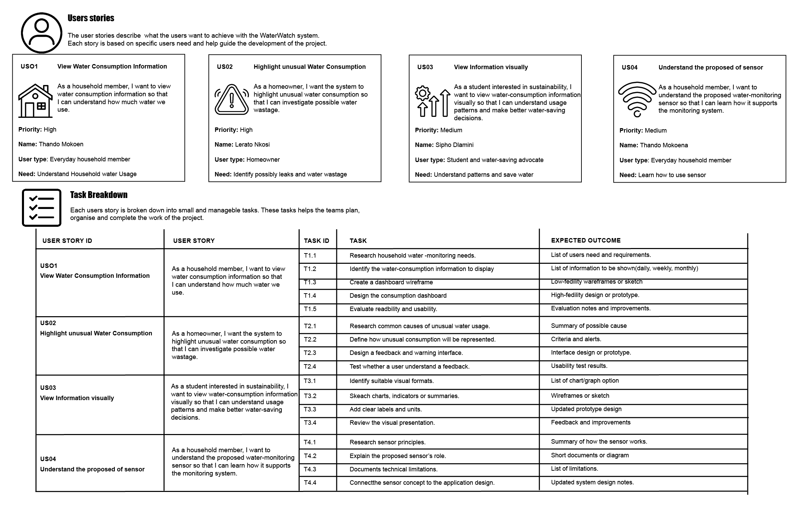

## **Prototype**

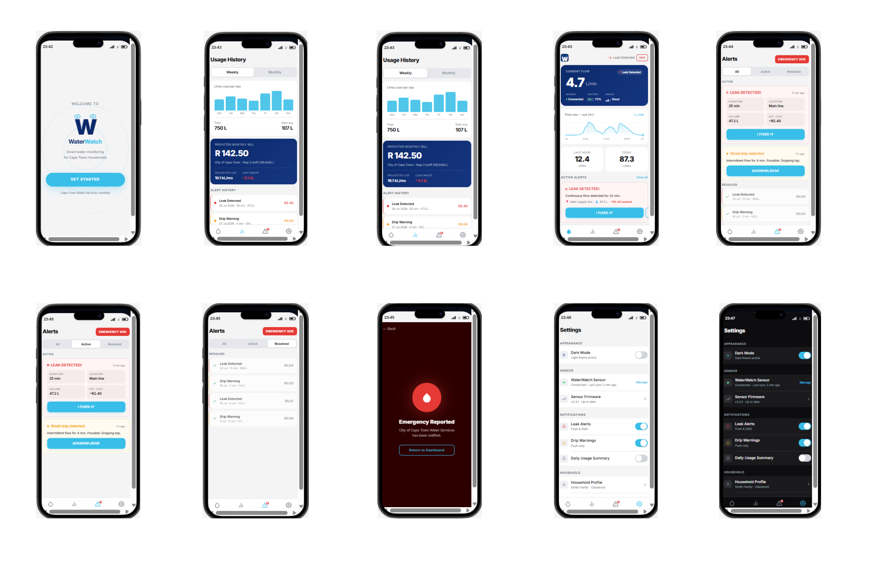

## **Brand Guidelines Presentation**

<video src="./WaterWatch.mp4" type="video/mp4" controls width="600"></video>

### **Conclusion**
WaterWatch user stories and tasks turn the project goals into user focused needs and into tasks that are easy to handle. WaterWatch user stories show the value that the new system is meant to bring while acceptance criteria explain how we can check that the needs are met. The task breakdown helps everyone know their role work together watch progress and stay on track, with the project plan.

When tasks are tied to WaterWatch user stories and we keep the task board and Agile logbook up to date the team can see how things are going and spot problems. Make changes. WaterWatch user stories keep the project centred on users by linking research, tech choices and interface design to what households need. WaterWatch user stories work best when we keep looking at the needs write down progress and make sure we separate what the prototype really does from what we only propose.

### **Reflection on User Stories and Tasks**
The WaterWatch user stories and task breakdown turn the project goals into user needs and into steps that can be done one by one. The persona artefacts show kinds of people who might use the system. The user stories explain what things the system should do for those people. The task breakdown then takes those needs. Turns them into actions like looking into what a home needs, designing the way people see the system, checking out the new sensor, and testing the model. This way of organizing things helps ensure the needs of the people using the system connect to the work the project is doing.

One good thing about this way of working is that it forces the team to think about why something's important instead of only looking at the technical details. For example a story about seeing information about how much water's used connects the new dashboard to a real need of a person in a home who wants to know how much water they use. Breaking that story into tasks such as research, design and testing makes the work easier to manage. The personas that are made based on guesses should not be shown as findings, from research. Their accuracy should be checked against studies. What people say.

The task breakdown also shows where some of the requirements need to be clearer. A requirement to show when water use is different for example needs rules that say what information will be used, how to show that the use is different and what the person should learn from the message. Acceptance criteria can help the team check if the design meets the need. Since WaterWatch is a model project the proof must show the difference, between whats planned and what has been done or tested.

To make this better, I would give every user story a number, link each story to its tasks, set clear acceptance criteria, and say what is important and what is done. I would also look at the stories again with the project research and the model that is available. Proof to use for this review would be the persona profiles, the table of user stories, the list of tasks, the acceptance criteria, and a specific example of a requirement that was made clearer or changed. This would show how the needs of the people were turned into work and how the process could be better.

---

## **Product Backlog**

### **Introduction**

The product backlog was made to organise and prioritise the work needed to reach the goals of the WaterWatch Intelligent Water Monitoring System. The product backlog gives an ordered list of requirements, features, research activities, improvements and evaluation tasks that help build the proposed solution.

WaterWatch wants to help households in Cape Town understand their water consumption, spot usage patterns and make smart choices about water conservation. The proposed solution uses a clamp‑on ultrasonic sensor together with a mobile interface that shows water consumption data in a clear and easy‑to‑understand way.

The product backlog links these objectives, to the user stories and tasks found in Step 2. The product backlog helps the team decide which requirements are most important which activities rely on work and how to use the nine‑week project period. Because the product backlog is an artefact the product backlog should be reviewed and updated as research results, technical limits and feedback change the project direction.

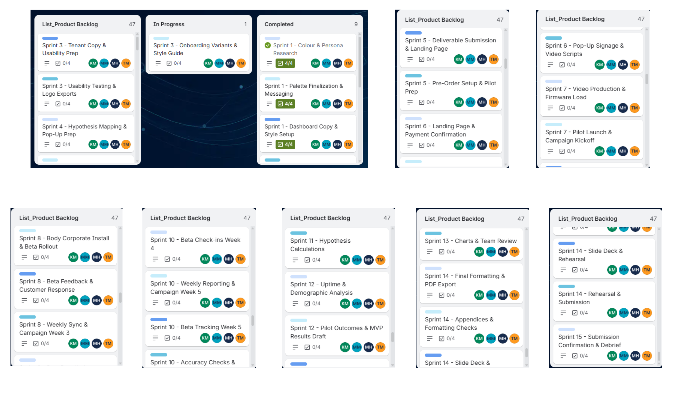

[Trello Link](https://trello.com/b/GTDSvPCj/waterwatch)

### **Conclusion**
The WaterWatch product backlog gives a way to organise the work needed to build the smart water monitoring system. By putting research user needs, the sensor idea, the mobile interface design, the prototype check and the final paperwork first the WaterWatch product backlog links the project’s goals to day‑to‑day tasks.

The WaterWatch product backlog also helps keep the work open and flexible by pointing out dependencies setting acceptance rules and giving a base, for changing priorities as the project moves forward. The WaterWatch product backlog works best when it is refined often planned realistically worked on by team members and when progress is written down accurately. Sticking to this way of working lets the team pay attention to the important needs and makes sure that the final e‑portfolio shows exactly what was planned, shown, tested and still needs more work.

### Reflection on the Product Backlog**
The WaterWatch product backlog lists all the work that must be done to build the Intelligent Water Monitoring System. It includes research figuring out what is needed, designing, building models and testing. The WaterWatch product backlog shows how the goals of the project are linked to the tasks that must be completed over nine weeks. The WaterWatch backlog and its related task board help the team see what matters understand how tasks are connected and look at what needs to be done when new information arises.

Prioritisation is important because the project has a limited amount of time and technical help. Looking into what people need in their homes and making sure the requirements are clear should help decide what kind of sensor and mobile app to build. Then designing the app to show the data about water use and testing the model must be planned in a way that matches the requirements and what the project can do. This order explains why things are done in an order, but the real backlog should be checked to see which tasks were most important and if their status shows they are done.

The backlog must stay open to change. Research or testing the model might show that a feature needs work that was not thought of before or that the data is not good enough for a planned function. For instance, any feedback about water use must be based on clear rules and good data. If real sensor data is not there, fake data must be marked clearly so the model does not look like it is using something that is not proven.

To make the backlog better I would note each tasks ID, what the task's how important the task is, the user story the task belongs to, what marks the task as completed who owns the task and which phase the task is in. I would also note changes to the task importance why those changes were made and how those changes touched the schedule. Evidence, for this approach comes from the product backlog the priority labels, the Trello board and a written example of a priority decision or a backlog change. This lets me verify whether the priorities served the project goals and whether the backlog reflected the work.

---
## **Sprint Backlog**

### **Introduction**
The sprint backlog for the WaterWatch Intelligent Water Monitoring System provides a plan for the work selected to achieve a sprint goal. It turns product backlog items into small tasks shows who is responsible for each task sets what needs to be accomplished and gives a way to check how the work is progressing during the sprint.

WaterWatch wants to help people in Cape Town understand how water they use identify unusual patterns in their usage and make better decisions about saving water. The plan is to use a sensor that does not need to be installed in the pipes and a mobile app that displays water use in an easy-to-understand way.

The sprint backlog aligns with the Week 6 project goal, which's about creating the design for the app making a model and explaining how the different parts of the system will work together. The work chosen builds on the research into what users need and the idea for the product that was developed earlier, in the project.

## **Spring Backlog**

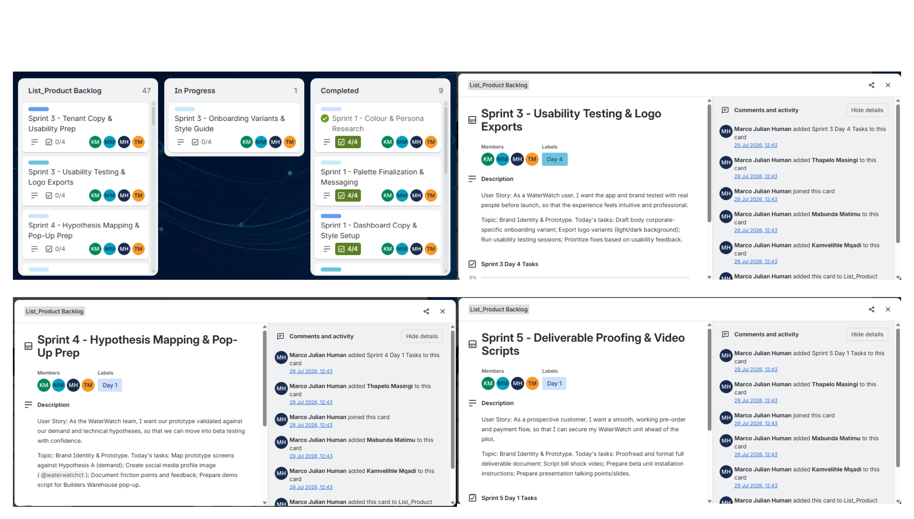

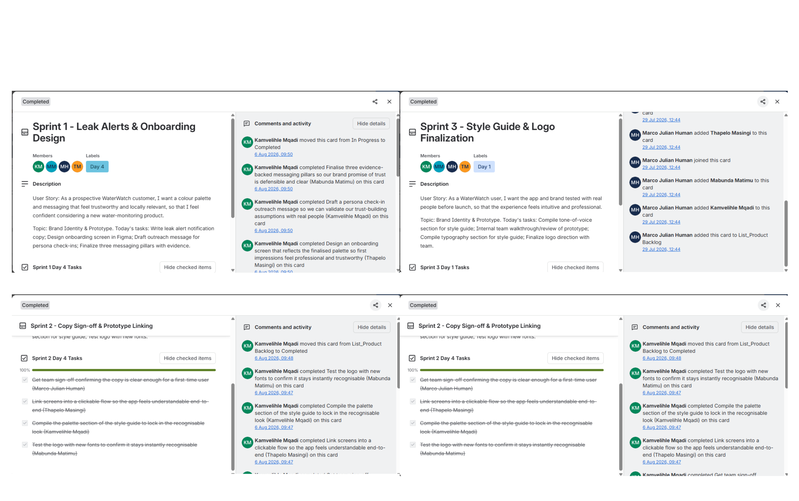

[Trello Link](https://trello.com/b/GTDSvPCj/waterwatch)

### **Conclusion**
The WaterWatch sprint backlog provides a plan, for creating and reviewing the mobile app prototype. It aligns with the Week 6 project goal by converting product backlog items into tasks. Each task is assigned following the Agile Team Charter and explicit acceptance criteria are defined to determine if the work satisfies expectations.

This WaterWatch sprint backlog keeps the team open and organized. Every member can see what is planned and how tasks depend on each other. It also helps track progress. Find ways to improve by using the Agile logbook and sprint review meetings.

The success of this WaterWatch approach depends on planning, teamwork, honest updates and checking results against set criteria. By maintaining these habits the WaterWatch team demonstrates a mindset. It also ensures that the digital portfolio clearly displays what is planned what is shown what is tested and what remains to be done.

### **Reflection on the Sprint Backlog**
The WaterWatch sprint backlog pulls items from the product backlog. It turns those items into a plan that helps reach the sprint goal. In the portfolio the work, for the sprint is linked to the Week 6 design and prototyping milestone. That link shows how the sensor concept, water usage data and the mobile app will work together. The sprint backlog also supports teamwork by showing which tasks are planned, who is doing each task and how the work moves toward the project goals.

A good part of sprint planning is that it helps people see the connections between tasks. For example, the design of the interface depends on knowing what water usage data the system can show. The way that data is shown should match the sensor idea, the data that's available, and what the project is trying to do. When people take ownership of tasks, it can help with being responsible. Tasks that need the system to work together might need more teamwork between people who do research, design the interface, and look into the technical parts.

The sprint plan should be checked against what happened, not just seen as proof that everything was done. The evidence that is given should show which tasks were done, which were still going on, and which were delayed or changed. If a task wasn’t finished, the reason and how it affected the goal should be written down. Also, any prototype that uses sample data should clearly say that the data is not real.

I want to make sprint planning better by set a sprint goal and links each task to the product backlog item it comes from. I will assign who is responsible. Set what needs to be done to finish the task. Track the task status during the sprint. At the end I will compare what was planned with what was done and write down what was learned for time. Evidence to support this reflection could be the backlog screenshots, who was assigned to what updates the task status of the prototype items and a real example of something that was done or not done in the sprint. This would show how the plan was used and what was learned from the outcome.

---
## **Agile Logbook**

### **Introduction**

I keep the WaterWatch Agile logbook to record planning, coordination, development activities, progress reviews and reflective discussions about the proposed WaterWatch Intelligent Water Monitoring System. The logbook helps the team use project management by showing how project activities match the agreed objectives, product backlog, user stories, sprint backlog and nine week project timeline.

WaterWatch aims to help households in Cape Town understand their water consumption recognises usage patterns and make informed decisions about water conservation. I see the proposed system as a blend of a non invasive clamp on ultrasonic sensor and a mobile app that displays consumption data in a clear and easy way. Because the project is, about conceptual design and a prototype demo the logbook must separate planned work that has been done, features that are shown and features that are still untested or only proposed.

I use the logbook to keep a record of stand ups, sprint planning sessions, task updates, review meetings, obstacles that were found, and retrospective talks. It also helps with accountability by naming the team members who're responsible writing down agreed actions and giving proof of how decisions were made during the project.

## **Agile Logbooks**

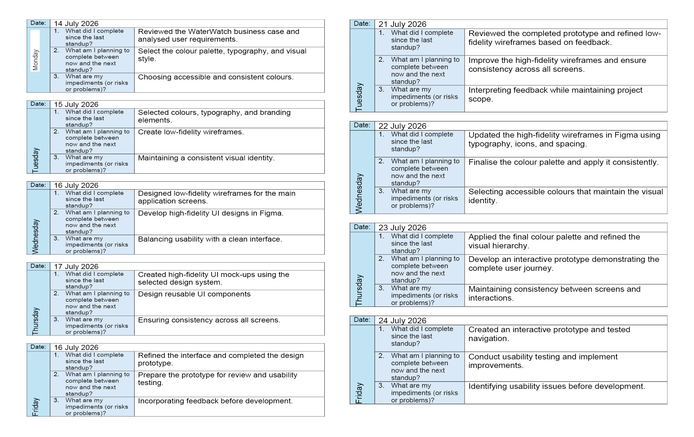

                                                                                                         

## **Conclusion**
The WaterWatch Agile logbook creates a way to write down what the team does for stand‑ups, sprint planning, checking progress, reviews and retrospectives. The WaterWatch Agile logbook lines up the team’s work with the project timeline. Lets us link who is in charge of each task and the decisions made to the goals the project wants to achieve.

The WaterWatch logbook is useful only if we write down what happens keep task status correct spot problems early and write down improvement steps. By giving visibility, responsibility and a habit of getting better the WaterWatch logbook lets the WaterWatch team show a way to manage projects while keeping a sharp line, between planned work, finished deliverables, shown prototype features and still‑open technical needs.

### **Reflection on the Agile logbook**
The WaterWatch Agile logbook is meant to keep a record of project planning, progress, decisions, challenges, and follow‑up actions. The WaterWatch Agile logbook links the Agile Team Charter, user stories, product backlog, and sprint backlog by being a place where project activities are noted as they change. When I keep the WaterWatch Agile logbook accurate, it helps the team spot work, track problems, and show why certain decisions were taken.

The usefulness of the WaterWatch Agile logbook depends on how good and consistent the entries are. When the WaterWatch Agile logbook records meeting task updates, uncertainties, and agreed actions, it shows how the team kept track of progress. For example, a note about an issue with the proposed sensor, consumption data, or interface design could explain why more research or a change to the work plan was needed. The WaterWatch Agile logbook’s introduction alone does not prove that every planned meeting took place or that every action was finished. Those claims must be backed by dated entries.

A problem with the WaterWatch Agile logbook is that entries missing dates or vague descriptions make it hard to confirm progress and responsibility. If the WaterWatch Agile logbook says only that a meeting happened, it tells us nothing about what was discussed what decision was made or what action came next. Therefore, the WaterWatch Agile logbook must give detail to link activities to specific tasks and project outcomes, and it must not claim results that are not actually recorded.

To improve the WaterWatch Agile logbook I would finish an entry after every meeting or major project activity. Each WaterWatch Agile logbook entry should include the date, the activity, the progress achieved, the tasks outstanding, any issues found, the decisions made, the person responsible and the next action. I would also check actions in later meetings and link the WaterWatch Agile logbook entries to the appropriate backlog items. Evidence that ties, into this reflection includes the dated WaterWatch Agile logbook entries, meeting or review records, task status updates, and a documented example of an issue and its follow‑up. Doing this would make accountability stronger. Help the team evaluate the project’s development more easily.

[WaterWatch App Link](https://witty-platinum-panda.92-205-106-102.cpanel.site/waterwatch/)

